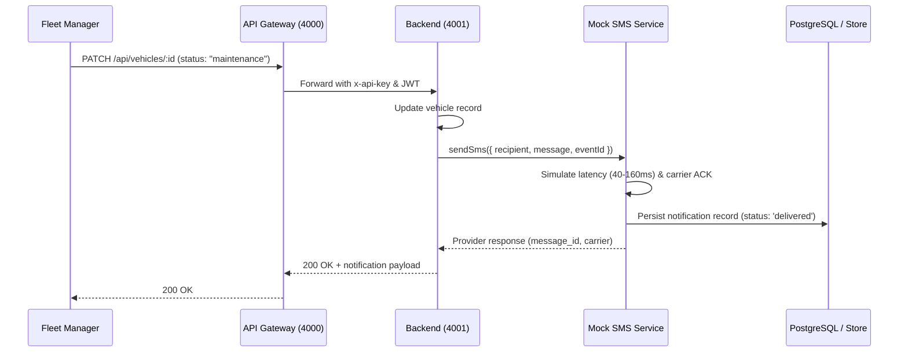

# Fleet Management System — System Architecture
**Staff Graded Assignment 2 (SGA 2)**

---

## 1. High-Level Architecture Overview

The system is organized as a modular monorepo containing three independently executable runtimes:

```
┌────────────────────────────────────────────────────────┐
│                   React Frontend                       │
│      Port 5173 | Vite + Tailwind + shadcn + Leaflet    │
└───────────────────────────┬────────────────────────────┘
                            │ x-api-key + Bearer JWT
                            ▼
┌────────────────────────────────────────────────────────┐
│                   API Gateway                          │
│     Port 4000 | Rate Limiting + Key Auth + Proxy       │
└───────────────────────────┬────────────────────────────┘
                            │ Reverse Proxy (http-proxy-middleware)
                            ▼
┌────────────────────────────────────────────────────────┐
│                   Backend Monolith                     │
│    Port 4001 | Express + JWT/RBAC + Zod + Modules     │
│   ┌──────────┬──────────┬──────────┬────────────────┐  │
│   │   Auth   │  Users   │ Vehicles │   Telemetry    │  │
│   ├──────────┴──────────┼──────────┴────────────────┤  │
│   │    Geolocation      │       Notifications       │  │
│   └─────────────────────┴───────────────────────────┘  │
└───────────────┬────────────────────────┬───────────────┘
                │ PostGIS SQL            │ Simulated Carrier
                ▼                        ▼
┌───────────────────────────────┐ ┌──────────────────────┐
│  Supabase PostgreSQL / PostGIS│ │   Mock SMS Service   │
│ ST_MakePoint(lng, lat)        │ │ Delivery receipts &  │
│ ST_DWithin radius search      │ │ status persistence   │
└───────────────────────────────┘ └──────────────────────┘
```

---

## 2. Network Boundaries & Port Allocation

| Component | Port | Base URL | Role |
|---|---|---|---|
| **Frontend** | `5173` | `http://localhost:5173` | Client web interface |
| **API Gateway** | `4000` | `http://localhost:4000` | Single entry point for all frontend client traffic |
| **Backend** | `4001` | `http://localhost:4001` | Modular business logic, DB access, Swagger UI (`/api-docs`) |
| **Swagger UI** | `4001` | `http://localhost:4001/api-docs` | Interactive OpenAPI 3.0 documentation |

---

## 3. Security Architecture & Separation of Concerns

### 3.1 Two-Layer Security Model
1. **API Gateway Layer (Port 4000)**:
   - Evaluates `x-api-key` header on all `/api/*` endpoints.
   - Evaluates client request rate limits (`express-rate-limit`: 100 requests / 60 seconds).
   - Forwards authenticated requests to the backend.
   - If downstream backend is down, returns structured HTTP 503 without leaking stack traces.
2. **Backend Service Layer (Port 4001)**:
   - Does **not** require API keys directly; trusts incoming traffic from the gateway.
   - Enforces **JWT Authentication** (`authenticateJWT`) on protected routes.
   - Enforces **Role-Based Access Control** (`authorizeRoles`) at the controller/service level:
     - `admin`: Full administrative rights, user role updates, vehicle deletion.
     - `fleet_manager`: Vehicle registration, status updates, telemetry intake, simulated notifications.
     - `viewer`: Read-only access to vehicles, telemetry, positions, and notifications.

### 3.2 Frontend Credential Hygiene
- All frontend environment variables use Vite's `VITE_` prefix (`VITE_API_URL`, `VITE_GATEWAY_API_KEY`).
- These variables are baked into client JavaScript and are considered public.
- Private signing secrets (`JWT_SECRET`) and database service role credentials (`SUPABASE_SERVICE_ROLE_KEY`) are kept exclusively on the backend in `backend/.env`.

---

## 4. Geolocation & PostGIS Engine

### 4.1 Coordinate Ordering
PostGIS requires coordinates in `(Longitude, Latitude)` order:
```sql
ST_SetSRID(ST_MakePoint(longitude, latitude), 4326)::geography
```
- Longitude (X-axis): -180.0 to +180.0
- Latitude (Y-axis): -90.0 to +90.0

### 4.2 Proximity Search Algorithm
The `find_vehicles_within_radius(center_lat, center_lng, radius_meters)` function:
1. Filters the latest telemetry record for each vehicle using `DISTINCT ON (vehicle_id)`.
2. Computes distance in metres:
   ```sql
   ST_Distance(lt.location, ST_SetSRID(ST_MakePoint(center_lng, center_lat), 4326)::geography) AS distance_meters
   ```
3. Filters with `ST_DWithin(lt.location, ST_SetSRID(ST_MakePoint(center_lng, center_lat), 4326)::geography, radius_meters)`.
4. Returns matching vehicles sorted ascending by `distance_meters`.

---

## 5. Mock SMS Notification Pipeline



When vehicle status changes or telemetry detects speed > 120 km/h or engine temp > 105°C:
1. An event is recorded in `vehicle_events`.
2. `mockSmsService.sendSms(...)` is invoked.
3. Carrier delivery is simulated (95% success rate, 5% failure on test numbers).
4. Full delivery receipt metadata (`message_id`, `carrier`, `latency_ms`, `status_code`) is saved in the `notifications` table.
