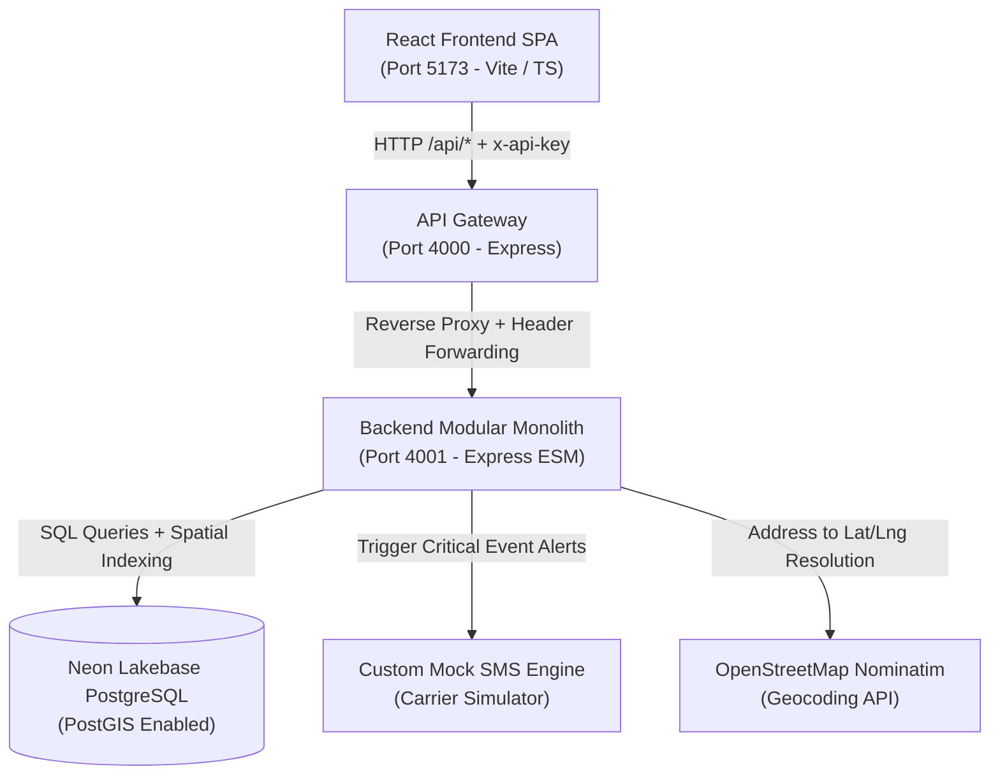
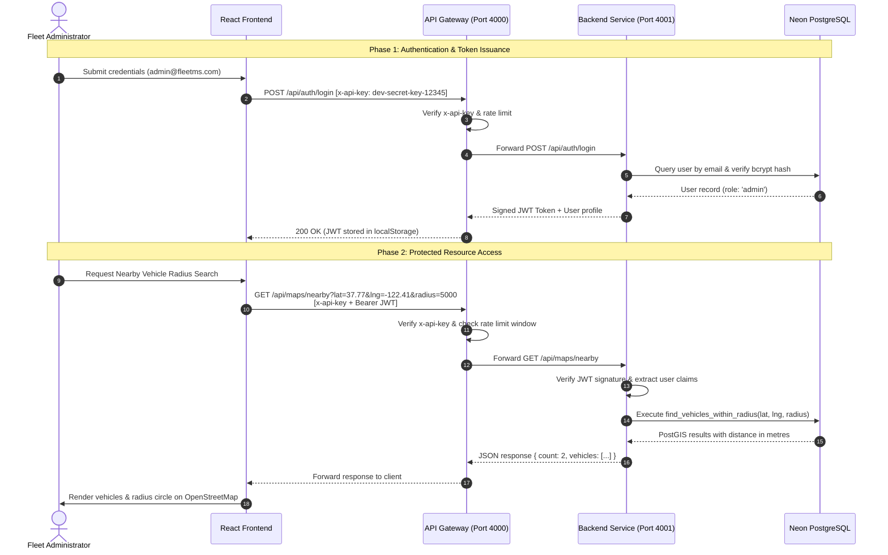
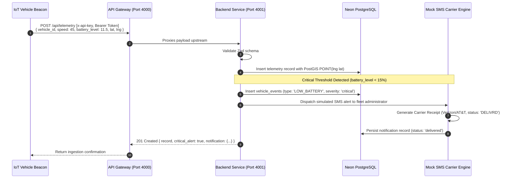
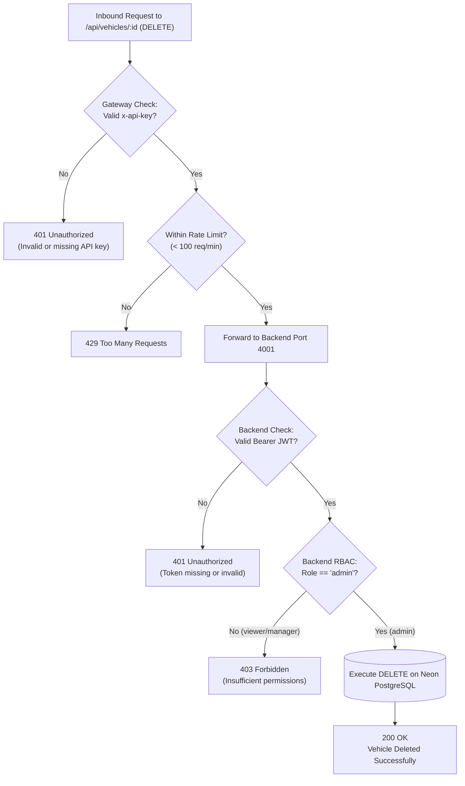

# Architecture Diagrams & Data Flows

## 1. System Topology Overview

---

## 2. Inbound Request & Authentication Flow

---

## 3. Telemetry Ingestion & Critical Event Notification Flow

---

## 4. Role-Based Access Control (RBAC) Enforcement Flow

